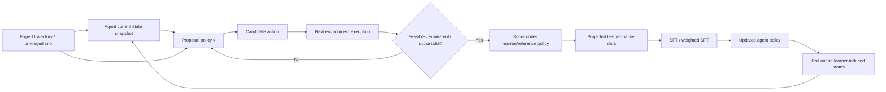

# 将《Finetuning with Sampling》迁移到交互式 Agent 场景的可行性与研究价值

## 执行摘要

**结论：值得深入研究，但不建议“直接迁移”原算法。更准确的判断是：核心思想高度可迁移，原始数学对象和采样算法在一般 Agent 环境中并不成立，必须重写成 environment-consistent projection。**

《Finetuning with Sampling: SFT Learns Better Than You Think》由 Aayush Karan、Sitan Chen 和 Yilun Du 于 2026 年 10 月 1 日发布。论文的核心不是改变 SFT loss，而是在训练前把 off-policy expert demonstrations 通过 MCMC 变成“更像 base model 自己会产生、但仍然正确”的轨迹，然后再做普通 SFT。论文在科学、数学和医学任务上证明这条路线有相当强的潜力；例如 Qwen2.5-3B 的数学实验中 Sampling SFT 达到 49.5%，高于 SFT 的 24.3%、GRPO 的 45.7% 和 UFT 的 47.0%，但它并非所有任务都绝对领先，例如医学新任务上 Sampling SFT 为 45.8%，略低于 OPSD 的 46.6%。citeturn15academia31turn2view3

我认为这篇论文真正值得迁移到 Agent 的不是其具体的“suffix MCMC”，而是下面这个原则：

> **不要强迫 learner 去拟合一个离它太远的 expert distribution；先利用 privileged expert information，把 demonstrations 投影到 learner 更容易实现的行为分布，再训练。**

这个原则和近年来关于 on-policy data、self-distillation、privileged exploration 的结果是高度一致的：Retaining by Doing 发现近似 on-policy 数据本身是减轻遗忘的重要因素；SDFT 用 demonstration-conditioned self-teacher 产生更 on-policy 的训练信号；UFT 与 POPE 则分别探索了监督信息与 RL、privileged information 与 on-policy exploration 的结合。citeturn19academia26turn19search2turn21academia10turn21academia11

但是，你之前的直觉是对的：**原论文最关键的理论前提在真正的 Agent 场景中通常不成立。**

静态 reasoning 中，模型修改第 \(t\) 个 token 后，后面的 token 仍然只是“文本候选”。Agent 中则不是如此：

\[
a_t \rightarrow o_{t+1} \rightarrow a_{t+1} \rightarrow o_{t+2}\cdots
\]

修改 \(a_t\) 会改变环境状态和随后 observation，因此不能保留旧的 \(o_{t+1:}\)。这正是经典 imitation learning 中 DAgger 所针对的结构性问题：**sequential prediction 的未来 observation 取决于之前的 action，因此 expert distribution 上的监督学习与 learner 自己诱导出的 state distribution 并不一致。**citeturn19search0turn19search3

因此，原论文的：

\[
p_{\theta}(x\mid q)
\]

需要在 Agent 中升级为：

\[
\rho_{\pi}(\tau\mid g)
=
\mu(s_0\mid g)
\prod_t
\pi(a_t\mid h_t,g)
P(s_{t+1}\mid s_t,a_t),
\]

而它要投影的也不应再是“correct text set”，而应该是**环境中实际可执行、满足任务目标与约束的 trajectory set**：

\[
\rho_{\pi_0,C}(\tau)
=
\frac{\rho_{\pi_0}(\tau)\mathbf 1[\tau\in C]}
{\int \rho_{\pi_0}(\tau')\mathbf1[\tau'\in C]d\tau'}.
\]

这是整个迁移问题的核心。

我的总体建议是：

| 路线 | 判断 | 原因 |
|---|---|---|
| 原论文 token/suffix MCMC 直接应用于 Agent logs | **No-Go** | 修改 action 后继续使用原 observation，会产生反事实上不可执行的轨迹 |
| 在固定 expert state 上做局部 action projection | **强烈建议先做** | 理论干净、实现便宜、最容易判断论文思想是否在 Agent 上成立 |
| 引入 environment replay 的完整 trajectory projection | **值得作为主研究方向** | 真正解决 causal state shift，理论和学术空间都大 |
| 直接上大规模 Agent RL | **不建议作为第一步** | 很难判断收益来自 sampling projection 还是 RL 本身 |
| 若局部 projection 有明确收益，再迭代成 online projection + RL | **中长期最有潜力** | 可形成介于 imitation learning、self-distillation 和 on-policy RL 之间的新范式 |

**我给这个方向的综合评级是：8/10，值得做。** 但论文题目应该更接近 **Environment-Consistent Finetuning with Sampling / Learner-Native Agent Imitation**，而不是“把 Finetuning with Sampling 用到 Agent”。截至 2026 年已有 HERO、HSL、AgentHER、Agent Lightning 等直接研究 multi-turn supervision、hindsight relabeling、agent credit assignment 与 RL，因此“multi-turn self-distillation”本身的新颖性已经不够；**真正有新意的是把原论文的 information projection 重新定义在 environment-induced trajectory distribution 上，并给出何时局部 projection / path-space projection 成立的理论条件。** citeturn15academia33turn15search12turn21academia13turn17search0

## 原论文的核心方法与理论前提

原论文考虑标准 autoregressive language model：

\[
p_\theta(x_{0:T}\mid q)
=
\prod_{t=0}^{T}p_\theta(x_t\mid x_{<t},q).
\]

普通 SFT 使用 expert dataset \(D\)：

\[
\mathcal L_{\mathrm{SFT}}
=
\mathbb E_{(q,x)\sim D}
[-\log p_\theta(x\mid q)].
\]

问题是 expert trace 可能是“正确的”，但对当前模型来说非常 off-policy：模型自身几乎不会用这种方式解决问题，因此直接强行增加其 likelihood，可能导致学习困难和能力干扰。论文提出不是修改 loss，而是**修改训练数据的分布**。citeturn2view0turn20view2

设对于给定问题 \(q\)，所有与 expert semantically equivalent、正确的答案集合为：

\[
C(q).
\]

再定义所有 support 只位于 \(C\) 内的 distribution：

\[
\mathcal P_C
=
\{\pi:\operatorname{supp}(\pi)\subseteq C\}.
\]

论文定义 base model \(p\) 在这个正确集合上的 information projection：

\[
p_C
=
\arg\min_{\pi\in\mathcal P_C}
D_{\mathrm{KL}}(\pi\Vert p),
\]

其解是：

\[
p_C(x)
=
\frac{p(x)\mathbf 1[x\in C]}
{\sum_{x'\in C}p(x')}.
\]

换句话说：**在所有正确答案里面，选择最像 base model 自己 distribution 的那些答案。**citeturn1view0turn1view1

直接从 \(p_C\) 采样困难，因此论文从现有 expert trajectory 初始化 Markov chain，通过保持 semantic information 的 proposal \(\kappa_C\) 修改 trajectory。理论上的 Metropolis-Hastings acceptance 为：

\[
A(x\rightarrow x')
=
\min\left(
1,
\frac{
p_C(x')\kappa_C(x\mid x')
}{
p_C(x)\kappa_C(x'\mid x)
}
\right).
\]

在 irreducibility、aperiodicity 以及 proposal 保持 \(C\) 等条件下，Markov chain 以 \(p_C\) 为 stationary distribution；论文进一步证明中间 distribution 到 base model 的 KL 可单调下降：

\[
D_{\mathrm{KL}}(\pi_{k+1}\Vert p)
\le
D_{\mathrm{KL}}(\pi_k\Vert p).
\]

citeturn2view1turn1view3

实际算法不是一次重写整个 solution，而是 blockwise 地生成 expert-conditioned proposal，再随机选位置重写 suffix。proposal 可以看到 query、原 expert solution 以及当前部分生成结果，利用 expert solution 作为 privileged information，使生成的 trace 尽量保持正确。论文明确指出，理论上要求 proposal 保持 semantic equivalence，而工程上则依赖 task-specific correctness 和这种 expert conditioning 来近似实现。citeturn1view4

值得特别注意一个实现细节。论文给出了标准 MH 形式，但当前公开的 `boost_sci.py` 实现中，proposal suffix 产生之后的核心 acceptance 判断实际上是：

```text
if target_log_prob_prop > target_log_prob_cur:
    accept(prop)
```

也就是只在 base-model likelihood 变高时接受，而公开代码该段并没有计算完整的 MH proposal-ratio。代码默认也使用 expert solution conditioning 来生成 proposal，并提供 MCMC steps 和 block 参数。citeturn14view0turn14view1

这意味着需要区分三件事情：

| 层次 | 原论文内容 | 对 Agent 迁移的意义 |
|---|---|---|
| 理论目标 | 对 correct set \(C\) 做 KL / information projection | **最值得保留** |
| 理论采样器 | information-preserving MH | Agent 中必须把 environment dynamics 纳入 |
| 公开工程实现 | expert-conditioned suffix generation + likelihood-improvement acceptance | 可以作为 heuristic baseline，但不能把论文完整理论保证直接套过去 |

原论文还有几个对迁移非常关键的经验结果。首先，boosted data 是 **learner-specific** 的：论文发现将针对一个 base model boosted 的数据用于另一个模型会明显恶化效果，这支持“training data 应该适配 learner distribution”这一核心思想。其次，随着 MCMC sampling 增加，生成轨迹总体会更加接近 reference model distribution，并伴随 downstream accuracy 提升，但收益与任务相关。citeturn1view4turn2view3

因此，我把原方法的关键假设归纳为：

| 假设 | 静态 reasoning 中 | Agent 中 |
|---|---|---|
| \(C(q)\) 可以定义 | 正确答案/语义等价 | 困难得多 |
| proposal 后的 trajectory 仍属于 \(C\) | 可以用 verifier / answer correctness 判断 | 必须实际执行环境才能确认 |
| 修改一个 suffix 不改变“世界” | 成立 | **一般不成立** |
| \(p(x\mid q)\) 是完整 trajectory 的参考概率 | 成立 | **不成立，还缺 environment transition** |
| expert future 可作为 privileged proposal 信息 | 通常安全 | 可能造成 future-observation leakage |
| projection 可以离线一次完成 | 通常可以 | learner state distribution 更新后容易过时 |
| 所有 token 的监督都相对合理 | 大体可接受 | Agent 中不同 action 的 credit 差异巨大 |
| correctness 接近 final-answer constraint | 常成立 | outcome、side effect、policy compliance 都要进入 \(C\) |

其中最后几项正是迁移时必须重新设计的部分。原论文自己将“semantic equivalence set”作为理论对象，并承认实际中需要 task-specific correctness 判定；在 Agent 中，这个 gap 会从次要工程细节变成算法核心。citeturn1view0turn1view4

## Agent 场景中的结构性断裂

对于一个 interactive agent，设历史：

\[
h_t=(o_0,a_0,o_1,a_1,\ldots,o_t),
\]

完整 trajectory：

\[
\tau=(s_0,o_0,a_0,s_1,o_1,a_1,\ldots,s_H).
\]

在 MDP/POMDP 下，trajectory density 至少包含：

\[
\rho_{\pi}(\tau)
=
\mu(s_0)
\prod_{t=0}^{H-1}
\pi(a_t\mid h_t)
P(s_{t+1}\mid s_t,a_t),
\]

若 observation 不是 state 本身，还需显式加入 observation kernel。HER 等经典 RL 工作也使用状态、动作、transition probability 和 reward 这样的交互式环境形式化。citeturn21search0

这与原论文的关键区别是：

\[
\boxed{
\text{LLM reasoning: modify }x_t
\not\Rightarrow
\text{external state changes}
}
\]

而：

\[
\boxed{
\text{Agent: modify }a_t
\Rightarrow
s_{t+1}\text{ changes}
\Rightarrow
o_{t+1}\text{ changes}
\Rightarrow
h_{t+1:}\text{ changes}
}
\]

因此，一个看起来非常自然的做法：

```text
expert trajectory:
o0, a0, o1, a1, o2, a2, ...

rewrite a1 -> a1'
keep o2, a2, ... unchanged
```

在一般情况下产生的并不是“另一个 successful trajectory”，而是一个**counterfactually impossible transcript**。

这不是小的实现偏差，而是 probability space 被改变了。DAgger 早在经典 imitation-learning setting 中就指出：当未来 observations 依赖先前 predictions/actions 时，训练分布和 learner deployment distribution 的差异会导致 sequential imitation 的问题，因此训练需要考虑由 learner 自身诱导的 observation distribution。citeturn19search0turn19search3

我认为至少有以下十个核心断裂点：

| 问题 | 具体机制 | 对原方法有效性的影响 |
|---|---|---|
| **action 改变导致 observation 分布改变** | \(a_t'\) 通常产生不同 \(o_{t+1}'\)，原 suffix 不再成立 | **高** |
| **trajectory feasibility** | 文本上“正确”的拼接 trace 可能在环境中根本无法发生 | **高** |
| **环境不可重放/不可逆** | 邮件发送、交易、网页状态修改等动作不能任意 rewind | **高** |
| **KL projection 的对象错了** | 应投影 \(\rho_\pi(\tau)\)，而不是只投影 LLM token likelihood | **高** |
| **长期 credit assignment** | terminal success 并不意味着所有中间 action 都值得 imitation | **高** |
| **offline / online state mismatch** | expert 访问的是 \(d_{\pi_E}\)，deployment 是 \(d_{\pi_\theta}\) | **高** |
| **privileged information leakage** | expert future observation/tool result 在实际 decision time 不可见 | **高** |
| **成功集合 \(C\) 难定义** | final state 相同也可能有不同成本、违规、副作用 | **高** |
| **partial observability / memory** | rewrite 后 memory、summary、context 都会发生变化 | **中-高** |
| **reference policy 过时** | 一轮 SFT 后 \(\pi_\theta\neq\pi_0\)，原 boosted data 再次 off-policy | **中-高** |
| **环境采样成本** | 每一次 proposal 可能意味着真正的 tool/env rollout | **高** |
| **verifier 错误** | LLM judge 误判 trajectory equivalence 会把错误 trace 变成正监督 | **中-高** |

其中最根本的是前四项。

设原 expert trajectory 中：

\[
(s_t,a_t^E,s_{t+1}^E).
\]

原论文式 proposal 给出：

\[
a_t'\sim\kappa(a\mid h_t,\tau_E).
\]

Agent 中真正需要检查的是：

\[
s_{t+1}'\sim P(\cdot\mid s_t,a_t').
\]

除非有：

\[
s_{t+1}'\equiv s_{t+1}^E,
\]

否则不能直接继续使用 expert suffix。

这里的“\(\equiv\)”甚至不一定意味着 raw state 完全相等；真正需要的是一种 continuation-equivalence：两个 state 对未来目标、可执行 action、约束和 reward 来说是等价的。这已经非常接近 bisimulation / state abstraction 类条件，而明显强于原论文对文本“semantic equivalence”的要求。

**KL projection 也必须升级。** 原论文实际上寻找：

\[
\arg\min_{q:\operatorname{supp}(q)\subseteq C}
D_{\mathrm{KL}}(q\Vert p_{\mathrm{LM}}).
\]

Agent 中正确的理想形式应是：

\[
\rho_C^*
=
\arg\min_{\rho:\operatorname{supp}(\rho)\subseteq C_{\mathrm{feasible}}}
D_{\mathrm{KL}}
\bigl(
\rho\Vert \rho_{\pi_{\mathrm{ref}}}
\bigr),
\]

其中：

\[
C_{\mathrm{feasible}}
=
\{
\tau:
\text{environment-valid}
\land
\text{task-success}
\land
\text{constraint-safe}
\}.
\]

这给出了一个非常明确的研究命题：

> **Finetuning with Sampling 在 Agent 中不应被定义成“rewrite agent logs”，而应该被定义成“从 reference policy 所诱导的可执行 trajectory distribution 中，条件采样 successful trajectories”。**

这也是我认为真正有论文价值的部分。

长期 credit assignment 是第二个容易被低估的问题。一个 episode 成功，不代表每个 action 都是好的：可能其中有无关查询、错误探索、重复工具调用，只是后来恢复成功。HSL 已经通过 irrelevant-action masking 和 sample reweighting 来缓解 successful hindsight trajectories 中的 suboptimal actions；HERO 则专门指出，将 single-turn self-distillation 天真扩展到 multi-turn Agent 会退化，并使用 subsequent environment observations 形成 turn-level hindsight diagnosis。Agent Lightning 也把 credit assignment 作为长程 Agent RL 的独立模块。citeturn15search12turn15academia33turn17search0

这说明：“找到 successful projected trajectory，然后对全轨迹无差别 SFT”本身也不够。

值得用下面这张图理解迁移后的正确数据流：



原论文主要覆盖 \(A\to C\to G\to H\)；Agent 迁移真正新增的是 **\(D\to E\to F\)** 以及最后的 **\(J\to K\to B\)**。

## 两套可迁移的改造算法

我建议不要从完整 MCMC trajectory sampler 开始，而是同时设计一套保守算法和一套理论上更完整的激进算法。前者用于快速验证核心假设，后者才是潜在论文主贡献。

**保守方案：Branch-and-Rejoin Projection，简称 BRP。**

BRP 不尝试 rewrite 整个 trajectory。它只在 expert 已经到达的真实 state 上重新寻找一个**更符合 learner distribution、同时会把环境带回同一个等价 successor state 的 action**。

对于 expert transition：

\[
(s_t,a_t^E,s_{t+1}^E),
\]

定义局部可接受 action set：

\[
C_t(s_t,s_{t+1}^E)
=
\left\{
a:
s'\sim P(\cdot\mid s_t,a),
\quad
s'\equiv s_{t+1}^E
\right\}.
\]

然后做局部 information projection：

\[
\pi^*_{C_t}(a\mid h_t)
\propto
\pi_{\mathrm{ref}}(a\mid h_t)
\mathbf 1[a\in C_t].
\]

也就是说：**不是改整条路线，而是在所有能够完成“同一步状态转换”的 action 表达方式中，找最像 learner 的那个。**

例如 expert tool action 是：

```text
search_orders(customer_id=123)
```

learner 更自然的行为可能是：

```text
get_customer_orders(customer_id=123)
```

如果两者从 snapshot 执行后得到同一个 canonical DB/tool state，则第二个可以替代第一个作为训练 target。

伪代码：

```python
for expert_episode in dataset:
    for t in expert_episode.decision_points:
        h = expert_episode.history[t]
        s = restore(expert_episode.snapshot[t])
        s_target = expert_episode.state[t + 1]

        current = expert_episode.action[t]

        for _ in range(N):
            # Expert future is privileged information used only by proposal.
            cand = proposal_policy.sample(
                history=h,
                expert_trajectory=expert_episode
            )

            restore(expert_episode.snapshot[t])
            obs_new, s_new = env.step(cand)

            if not constraints_satisfied(s_new):
                continue

            if not equivalent(s_new, s_target):
                continue

            # Exact MH if proposal probabilities are available;
            # otherwise use learner-likelihood improvement as heuristic.
            if mh_accept(
                old=current,
                new=cand,
                target_policy=reference_policy,
                proposal_policy=proposal_policy
            ):
                current = cand

        training_data.add(
            history=h,
            target_action=current
        )

finetune(policy, training_data)
```

其理论直觉非常清楚。如果：

\[
s_{t+1}'\equiv s_{t+1}^E
\]

意味着两个 state 对后续任务具有相同的 sufficient information，那么替换 \(a_t^E\) 不改变 continuation problem。这样可以把原论文的“semantic-preserving proposal”改造成“state-transition-preserving proposal”。

它最大的优点是，**不需要为整个 Agent environment 建立可计算的 trajectory density，也不需要伪造 observation。** 每一个训练 example 都对应真实访问过的 history；candidate action 也真正从该 state 执行过。

BRP 的主要边界是：有些环境根本不存在很多“branch-and-rejoin”的 action。例如点击错误按钮后网页状态已经不同；数据库 transaction 有副作用；机器人移动一步会持续改变物理状态。此时 \(C_t\) 很小，甚至只有 expert action 本身，projection 就没有空间。

另一个边界是 equivalence verifier。对于 ALFWorld，可以直接比较 symbolic state；对于 τ-bench，可以比较规范化 database state；而对于 WebArena，DOM、数据库和页面状态可能需要任务相关 canonicalization。ALFWorld 提供 text/embodied 对齐的交互环境，τ-bench 明确通过最终 database state 评估 agent 行为，WebArena 则提供可复现、完整功能的网站环境，因此三者非常适合按这个难度梯度验证 BRP。citeturn17academia27turn17search7turn17academia26

BRP 的最大潜在风险不是性能低，而是“equivalence 太宽”。如果仅比较最终 observation 文本或让 LLM judge 判断“差不多一样”，很容易把具有不同隐藏状态和 side effect 的 transition 当成等价。因此 MVP 应尽可能使用 structured environment state，而不是 LLM semantic judge。

**激进方案：Environment-Consistent Projection Sampling，简称 ECPS。**

ECPS 直接把原论文的 information projection 重写到 Agent path space。

目标 distribution：

\[
\rho^*(\tau)
\propto
\rho_{\pi_{\mathrm{ref}}}(\tau)
\mathbf 1[C(\tau)].
\]

其中：

\[
\rho_{\pi_{\mathrm{ref}}}(\tau)
=
\mu(s_0)
\prod_t
\pi_{\mathrm{ref}}(a_t\mid h_t)
P(s_{t+1}\mid s_t,a_t).
\]

privileged proposal 为：

\[
q_\kappa(\tau\mid\tau_E)
=
\mu(s_0)
\prod_t
\kappa(a_t\mid h_t,\tau_E)
P(s_{t+1}\mid s_t,a_t).
\]

关键点在于：**candidate observation 永远不是模型写出来或从 expert log 复制出来，而是实际由 environment \(P\) 产生。**

如果 proposal 与 target 使用相同的 environment kernel，那么 sequential importance ratio 中环境项可以相消：

\[
\frac{\rho_{\pi_{\mathrm{ref}}}(\tau)}
{q_\kappa(\tau\mid\tau_E)}
=
\prod_t
\frac{
\pi_{\mathrm{ref}}(a_t\mid h_t)
}{
\kappa(a_t\mid h_t,\tau_E)
}.
\]

这提供了一条很重要的路线：**即使不知道环境 transition probability，只要能够从真实/模拟环境采样，并且 proposal action probability 可计算，仍然可以使用 Sequential Monte Carlo 类方法近似目标 path distribution。**

SMC 在语言模型受约束采样中已有相关先例，原论文自身也引用了 probabilistic-program steering 与 twisted SMC 文献作为相邻采样路线。citeturn20view0

实用 ECPS 可以维护 \(K\) 个 particle：

```python
reference_policy = base_policy

for round in range(R):
    projected_data = []

    for task, expert_trace in expert_dataset:
        particles = initialize_from_same_task_state(task, K)

        for t in range(max_horizon):
            new_particles = []

            for p in particles:
                # Privileged expert information guides exploration,
                # but is NOT part of the deployed policy input.
                a, log_q = privileged_proposal.sample(
                    history=p.history,
                    expert_trace=expert_trace
                )

                obs_next, state_next = p.env.step(a)

                if hard_constraint_violation(state_next):
                    continue

                log_pi = reference_policy.logprob(
                    a, given=p.history
                )

                p.log_weight += log_pi - log_q

                # Optional intermediate potential.
                p.log_weight += progress_potential(
                    state_next, expert_trace
                )

                p.append(a, obs_next, state_next)
                new_particles.append(p)

            particles = resample(new_particles, K)

            # Optional MCMC rejuvenation:
            # branch from a snapshot and ACTUALLY replay the environment.
            particles = environment_rejuvenation(
                particles,
                reference_policy,
                privileged_proposal
            )

        successful = [
            p for p in particles
            if task_success(p)
            and constraints_satisfied(p)
        ]

        for trajectory in successful:
            credit = estimate_turn_credit_by_branching(trajectory)
            projected_data.add(
                trajectory,
                action_weights=credit
            )

    policy = weighted_sft(
        policy,
        projected_data
    )

    # Important: projection should follow the learner as it moves.
    reference_policy = update_reference(policy)
```

这个算法和原论文最核心的哲学仍然一致：

\[
\text{expert information}
\rightarrow
\text{learner-native successful samples}
\rightarrow
\text{ordinary supervised learning}.
\]

区别是，它把 projection 从：

\[
\text{text space}
\]

提升到了：

\[
\text{environment-consistent trajectory space}.
\]

这一方案还有一个重要改动：**reference policy 应迭代更新。**

原论文是：

\[
D_E
\xrightarrow{\text{project toward }\pi_0}
D_{\mathrm{proj}}
\xrightarrow{\mathrm{SFT}}
\pi_1.
\]

Agent 中我更推荐：

\[
\pi_0
\rightarrow D_0
\rightarrow \pi_1
\rightarrow D_1
\rightarrow \pi_2
\rightarrow\cdots
\]

因为 \(\pi_1\) 部署后诱导的 state distribution 已经不同于 \(\pi_0\)。这个结构与 DAgger “训练 learner 自己会访问的状态”以及现代 iterative self-distillation 的逻辑更一致。DAgger 的核心理论动机正是消除 learner-induced observation distribution 与 expert data distribution 的 mismatch。citeturn19search0

ECPS 中我还建议加入**turn-level credit mask**。定义：

\[
c_t
\approx
V(h_t,a_t)
-
\mathbb E_{a\sim\pi_{\mathrm{ref}}}
V(h_t,a).
\]

实践中不一定需要训练 critic，可以从 snapshot 做少量 counterfactual branch rollouts，估计替换 \(a_t\) 后成功率如何变化。训练 loss：

\[
\mathcal L
=
-\sum_t
w_t
\log\pi_\theta(a_t\mid h_t),
\]

其中：

\[
w_t=f(c_t).
\]

这样就不会因为一条 trajectory 最终成功，而把其中所有无效 action 都当作同等质量的 expert supervision。HSL 的 irrelevant-action masking、HERO 的 turn-level hindsight feedback 与 Agent Lightning 的 credit-assignment module 都说明 multi-turn agent training 中这一问题具有现实重要性。citeturn15search12turn15academia33turn17search0

两种方案可以总结为：

| | BRP | ECPS |
|---|---|---|
| Projection 单位 | 单个 state-action transition | 完整 trajectory |
| Environment execution | 局部 branch | 全程真实 rollout |
| 理论难度 | 低-中 | 高 |
| 环境成本 | 低 | 高 |
| 是否解决 state-distribution shift | 部分 | 是，若迭代 rollout |
| 是否可以离线预处理 | 较多 | 较少 |
| 是否需要 snapshot/reset | 强烈建议 | 基本需要 |
| Novelty | 中高 | **高** |
| 工程风险 | 低-中 | 高 |
| 推荐阶段 | **第一阶段** | 第二阶段 |

## 实验设计与对照矩阵

实验的首要目标不是追 SOTA，而是回答一个干净的因果问题：

> **把 expert trajectory 转换成“更接近 learner，同时仍然 environment-valid”的 demonstrations，是否比直接 SFT、rewrite、rejection sampling 和 on-policy RL 更 sample-efficient？**

因此第一轮必须严格做 compute matching。

推荐的环境梯度如下：

| 任务类型 | 环境 | 为什么适合 | 核心 verifier | 主要挑战 |
|---|---|---|---|---|
| 文本 embodied agent | **ALFWorld** | text-based interactive simulator，与 embodied environment 对齐；适合快速大量 branch | symbolic world state + goal success | 长程 action、state shift |
| Tool/API agent | **τ-bench / 当前维护任务版本** | 动态 user + domain API + policy；最终 DB state 可精确检查 | database goal state + policy constraints | side effect、规则遵循、用户交互 |
| Web agent | **WebArena** | 可复现完整网站，包括电商、论坛、开发和 CMS 等领域 | functional correctness + website state | 页面状态、不可逆 action、长 horizon |
| Coding agent，扩展阶段 | **SWE-bench 类环境** | code edit + execution feedback，非常适合验证 branch/replay | tests | 高环境成本、长上下文 |

ALFWorld 的论文明确将 text-based policies 与 embodied execution 对齐；WebArena 被设计成 realistic、reproducible 的完整 web environment；τ-bench 将 dynamic simulated user、API tools 和 policy guidelines 放在同一个 environment 中，并通过 final database state 与 annotated goal state 比较结果，还提出了 `pass^k` 来衡量多次执行可靠性。citeturn17academia27turn17academia26turn17search7

τ-bench 需要注意版本问题：目前官方仓库已经明确警告原 airline/retail task 文件已过时，并建议使用更新的 τ³-bench task set。因此若目标是论文 comparability，可以保留原 τ-bench evaluation；若目标是当前系统有效性，应同时使用官方维护的更新 task pack。citeturn17search4

**对照组必须比一般论文做得更强。**

| 对照 | 数据来源 | 是否环境交互 | 目的 |
|---|---|---:|---|
| Base model | 无训练 | 否 | 原点 |
| Expert SFT / BC | expert demonstrations | 否 | 标准 imitation baseline |
| Original token-only Sampling | expert trace rewrite | 否 | **关键负对照：验证直接迁移是否错误** |
| Rewrite SFT / 0-step MCMC | expert-conditioned rewrite | 否 | 区分 proposal 本身与 projection |
| Rejection Sampling SFT | learner 完整 rollout，只保留 success | 是 | 最直接 successful on-policy data baseline |
| SDFT/OPSD 风格 | expert-conditioned learner generation | 有限 | on-policy self-distillation baseline |
| DAgger | learner states + expert labels | 是 | sequential imitation baseline |
| GRPO/PPO 类 on-policy RL | learner rollout + reward | 是 | 强 RL baseline |
| UFT / POPE 风格 privileged RL | expert info 辅助探索 | 是 | 与本研究最相近的 privileged baseline |
| **BRP** | expert states + local env branches | 是 | 保守方案 |
| **ECPS** | expert-guided environment-consistent rollouts | 是 | 主算法 |
| ECPS + RL | projected warm start 后 on-policy RL | 是 | 是否与 RL 互补 |

UFT 将 supervised 与 reinforcement fine-tuning 统一；POPE 则专门使用 oracle/expert solution 作为 privileged information 来解决困难问题上 on-policy exploration 几乎无法产生正奖励的问题，因此它们是非常重要的强对照。citeturn21academia10turn21academia11

DAgger 必须纳入，因为它直接解决 learner-induced state distribution；GAIL 可以作为较经典的 occupancy-level imitation baseline，但考虑 LLM Agent 的训练成本，我把它放在可选项。citeturn19search0turn19academia24

推荐主指标：

| 指标 | 定义 | 为什么重要 |
|---|---|---|
| Task success | episode 完整成功率 | 主结果 |
| `pass^k` / repeated reliability | 多次 rollout 持续成功程度 | Agent 可靠性；τ-bench 原生使用此思想 citeturn17search7 |
| Constraint violation rate | policy / safety / side-effect 违规比例 | 防止“成功但违规” |
| Projected feasibility rate | projected transition/trajectory 可真实 replay 的比例 | **检验核心理论问题** |
| Success / \(10^6\) generation tokens | 单位 inference compute 成功收益 | 与 rejection/RL compute match |
| Success / \(10^5\) env steps | 环境 sample efficiency | ECPS 的核心成本 |
| Action KL to reference | learner/projected action distribution 与 reference proximity | 检验 projection |
| Avg. unnecessary turns | 完成任务所需额外行动 | 检查 sampling 是否学到冗余行为 |
| Retention | 原有 agent/general capabilities 的变化 | 复现原论文“更少遗忘”命题 |
| Recovery success | 偏离 expert path 后恢复成功率 | 比纯 expert BC 更能反映 Agent 泛化 |

原论文的主要主张之一就是更 learner-native 的数据可以减少遗忘，而 Retaining by Doing 和 SDFT 也分别从 on-policy-data 与 self-distillation 角度得到相近结论，因此 retention 不应只是附属指标。citeturn19academia26turn19search2turn15academia31

**训练流程建议：**

```text
Expert demonstrations
        ↓
Record canonical states + snapshots + tool results
        ↓
Run baseline SFT
        ↓
BRP local projection
        ↓
Train BRP-SFT
        ↓
Compare with SFT / Rewrite / RS / DAgger
        ↓
Only if BRP shows signal:
        ↓
ECPS path-space sampling
        ↓
Weighted SFT
        ↓
Iterative redeployment
        ↓
Optional ECPS → RL stage
```

第一阶段千万不要同时引入 RL，否则实验会回答不了“projection sampling 本身是否有价值”。

**本文建议的初始超参数，不是原论文已验证值：**

| 参数 | BRP MVP | ECPS |
|---|---:|---:|
| candidate actions / state | 4 / 8 | particle \(K=4/8/16\) |
| projection steps | 0 / 1 / 2 / 4 / 8 | 每轮 1–4 rejuvenation |
| branch horizon | 1；再扩展至 2–3 | 完整 episode |
| reference | 固定 \(\pi_0\) + iterative 两组 | 每轮更新 |
| proposal temperature | 0.4–0.8 | 0.4–0.8 |
| train epochs | 1–2 起步 | 1–2 / round |
| rounds | 1 | 2–4 |
| credit mask | 无/有 | 无/有 |
| equivalence | exact → canonical → learned | terminal verifier + constraints |

原论文公开实验中使用 \(N_{\text{MCMC}}=10\)，论文正文还报告了 block 参数、最大 sequence length 1856，并使用 H100/H200；SFT 网格包括 1–2 epochs、多个 learning rate/batch size。公开代码中 proposal temperature 为 0.6，并支持 `mcmc_steps` 和 `block_num`。不过论文的算法记号 \(B\) 与公开代码的 `block_num` 定义不完全同构，因此 Agent 实验不应机械复制这些 block 超参数。citeturn2view3turn14view0turn12view0

**最重要的 ablation 清单：**

| Ablation | 要回答的问题 |
|---|---|
| token-only rewrite，不执行 environment | state consistency 是否真的是关键？ |
| MCMC steps = 0 | 收益只是 privileged rewrite 吗？ |
| exact state equivalence vs semantic equivalence | verifier 精度有多关键？ |
| 不看 expert future | privileged info 本身贡献多少？ |
| expert solution vs expert solution + future observations | 是否出现 future leakage？ |
| 固定 \(\pi_0\) vs 每轮更新 reference | stale projection 是否严重？ |
| no credit mask | 成功轨迹中的 bad actions 是否伤害学习？ |
| BRP horizon 1/2/4 | 多远的 branch-and-rejoin 才有收益？ |
| particles 4/8/16 | trajectory search 的 compute scaling |
| compute-matched rejection sampling | projection 是否真的比“多采样成功轨迹”高效？ |
| same-model vs cross-model projected data | 检验原论文 learner-specific data 现象 |
| deterministic vs stochastic seeds | 方法是否依赖精确 replay？ |
| only expert states vs learner-induced states | DAgger-style state aggregation 的价值 |
| SFT vs BRP→RL / ECPS→RL | projection 与 RL 是替代还是互补？ |

尤其是 **cross-model projected data** 很值得做。原论文发现 boosted data 与 reference learner 具有明显 model specificity；如果 Agent 中也出现同样现象，会非常有力地支持“learner-native demonstration”作为普适 post-training primitive，而不只是一个 sampling trick。citeturn1view4

## 资源预算与实施路径

下面不是论文报告的实际消耗，而是基于 3B–7B open-weight model、当前 Agent benchmark 交互复杂度以及原论文 sampling structure 给出的**工程预算区间**。实际值会显著受 context length、batching、environment latency、vLLM throughput 和是否 full fine-tuning 影响。

原论文的实验本身使用 Qwen2.5-3B/7B 和 OLMo 等规模，并报告使用 H100/H200；其公开实现把 sampling 作为一次性的 preprocessing。SDFT 的公开代码则说明其论文实验可在单张 H200 上运行，这说明 3B–7B 级 learner-native data transformation 至少可以在单节点级别研究，而不要求 frontier-scale cluster。citeturn2view3turn12view0turn19search14

| 阶段 | 目标 | 模型 | 数据规模 | 环境交互预算 | GPU 预算，工程估算 | Wall-clock 估算 |
|---|---|---|---:|---:|---:|---:|
| **最小可行验证** | 判断 BRP 有没有 signal | 3B–7B | 500–2,000 episodes | \(10^5\) 量级 branches | 30–100 H100-equivalent GPU-h | 2–5 天 |
| **小规模研究** | 完整 ALFWorld + τ 子集 | 7B | 2k–10k episodes | \(10^5\)–\(10^6\) | 100–500 GPU-h | 约 1 周 |
| **中等规模** | 3 environments、3 seeds、强 baselines | 7B–14B | 10k–50k episodes | \(10^6\)–\(10^7\) | 1k–5k GPU-h | 1–3 周 |
| **生产/论文强化版** | 多模型 + ECPS + RL | 14B–70B | 50k+ episodes | \(10^7+\) | 10k–50k+ GPU-h | 3–8 周 |

这里最容易爆炸的不是 SFT，而是 **environment branching × candidate count × horizon**。

BRP 的 environment complexity 大约为：

\[
N_{\mathrm{env}}
\approx
N_{\mathrm{episodes}}
\cdot
H
\cdot
K_{\mathrm{candidate}}.
\]

ECPS 则约为：

\[
N_{\mathrm{env}}
\approx
N_{\mathrm{tasks}}
\cdot
R
\cdot
K_{\mathrm{particle}}
\cdot
H
\cdot
(1+\text{rejuvenation factor}).
\]

因此，从 BRP 开始有明显工程优势：它可以在几万个 state-action points 上快速判断 hypothesis，而无需先解决大规模 distributed Agent RL。

**最低可行资源配置我建议是：**

> **1× 80GB 级 GPU + 一台多核 CPU environment server + 128–256GB system RAM + 可 snapshot 的 ALFWorld 环境。**

模型先选择 3B 或 7B；sampling 与 LoRA/SFT 可以串行使用同一 GPU。若有两张 GPU，最舒服的配置是一个 inference worker 持有 frozen reference/proposal，另一个用于训练，但不是必要条件。

MVP 数据建议：

\[
500\text{–}1000
\text{ training tasks}
\]

每个 expert decision point 做：

\[
K=4
\]

个 candidate branches，先只做 horizon-1 exact/canonical-state equivalence。

这一个实验就足以回答三个非常关键的问题：

1. expert action 周围是否真的存在大量 learner-likely、environment-equivalent alternatives；
2. 投影之后 action NLL / KL 是否显著靠近 base learner；
3. 用这些 projected actions 做 SFT 后，end-to-end Agent success 是否高于普通 expert SFT。

如果这三个问题中前两个都是否，就无需进入 ECPS。

我建议开发顺序严格控制：

| 周期 | 实现 |
|---|---|
| 第一阶段 | expert state snapshot + exact transition replay |
| 第二阶段 | BRP + SFT + original token rewrite negative control |
| 第三阶段 | rejection sampling + DAgger compute-matched baseline |
| 第四阶段 | iterative BRP |
| 第五阶段 | ECPS particles + full environment rollout |
| 最后 | ECPS→RL |

这种顺序最大的好处是：任何阶段失败，都能知道假设具体死在哪里，而不是得到一个“Agent training 没涨点”却不知道原因的结果。

## 风险、Go/No-Go 与研究价值

最严重的风险可以概括成一句：

> **Agent 上可能并不存在一个足够大的“successful + environment-equivalent + learner-likely”邻域。**

原论文在 text reasoning 中有大量表达级自由度：同一道数学题可以用不同措辞、不同 reasoning style 达到同一答案。但 Agent action 往往离散得多，例如“点击购买”“删除文件”“调用退款 API”。action 的细微改变就可能造成不同 world state，因此 information projection 的可行集合可能比文本任务窄很多。

这其实是最重要的科学问题之一，而不是单纯工程风险。

| Failure mode | 表现 | 后果 | 缓解 |
|---|---|---|---|
| Projection set 太小 | 几乎所有 candidate 都无法 rejoin | BRP 没有价值 | 转向 macro-action / full ECPS |
| Projection set 太宽 | verifier 把不同 hidden states 判成 equivalent | 错误监督 | structured state hash |
| Privileged leakage | train 涨、部署不涨 | 数据不可因果执行 | future-info ablation |
| Particle collapse | ECPS 大量权重集中于 1 个 particle | 无有效多样性 | tempering / intermediate potentials |
| Base support 太低 | expert-needed action \(\pi_0\) 极低 | projection 拉回错误模式 | expert-guided proposal + later RL |
| Long horizon explosion | branch cost 指数增长 | 不可扩展 | local projection + hierarchical checkpoints |
| Credit contamination | successful trace 里的坏动作被 SFT | 行为冗余、失败恢复差 | action masking / branch credit |
| Reference staleness | Round-1 数据对 Round-3 policy 又 off-policy | 收益饱和 | iterative projection |
| Reward/verifier hacking | final state 成功但违规 | 虚假提升 | hard policy constraints |
| Benchmark replay bias | 只适用于 deterministic simulator | 无法推广生产 | stochastic/no-reset ablation |

AgentHER 和 HSL 证明“失败轨迹经过 hindsight 处理可以成为有价值的 Agent training data”，而 HERO 明确发现 naive multi-turn self-distillation 会因为 feedback 与当前 decision context 对不齐而退化。这两类结果一正一反，都支持这里的判断：**Agent trajectory transformation 确实有潜力，但必须尊重 turn-level/environment-level causal structure。**citeturn21academia13turn15search12turn15academia33

我建议事先固定以下量化 Go/No-Go 门槛，而不是看到结果后再解释。以下阈值是**本文建议的研究决策标准，不是已有论文标准**。

| 判据 | Go | No-Go |
|---|---|---|
| **最终成功率** | compute-matched 情况下，相对最强 SFT/RS baseline 在 ≥2/3 环境提升 **≥5 absolute pp** | 三环境均 <2 pp 或不稳定 |
| **Sample efficiency** | 达到相同成功率所需 env interactions 减少 **≥25%**，或 success / env-step 提高 ≥1.5× | 比 rejection/on-policy 需要 >2× environment cost |
| **Projection feasibility** | BRP candidate 中至少 **20–30%** 能形成有效等价 transition，并随 sampling 得到更高 \(\pi_{\rm ref}\) likelihood | <5–10%，说明 local projection space 太窄 |
| **Replay validity** | 训练数据 structured replay correctness **≥99%** | >1–2% projected traces 与真实环境不一致 |
| **Retention** | target gain 明显且 prior-task drop **≤2 pp** 或明显优于 SFT | target gain 来自明显 prior degradation |
| **迭代价值** | Round 2–3 仍继续改善 learner-state performance | 只第一轮有效，之后迅速饱和 |
| **相对 RL 的价值** | 接近 RL 成功率但显著减少 reward/env cost，或给 RL 更好 warm start | 性能≤RL 且 compute/env cost≥RL |

第一个真正的“killer criterion”其实不是最终 accuracy，而是：

\[
\boxed{
\Pr_{a'\sim\kappa}
[
a'\in C_t
\land
\log\pi_0(a'|h_t)>
\log\pi_0(a_t^E|h_t)
]
}
\]

也就是：

> **在一个 expert state 周围，究竟有多少行为既能完成同样的状态转换，又比 expert action 更符合 learner 自身 policy？**

如果这个概率在多数 Agent task 上非常低，那么原论文的核心几何直觉在 Agent action space 中就不成立，至少局部 BRP 不值得继续。

如果这个概率很高，则是极强的研究信号。

学术价值方面，我会这样评分：

| 方向 | 新颖性 | 工程价值 | 潜在影响 |
|---|---:|---:|---:|
| 原论文方法直接跑 Agent transcript | 2/5 | 1/5 | 1/5 |
| BRP：state-equivalent projection | **4/5** | **4/5** | 4/5 |
| ECPS：path-space information projection | **4.5/5** | 3/5 | **5/5** |
| ECPS + iterative learner distribution | 4/5 | 3/5 | **5/5** |
| 单纯 expert-conditioned self-distillation | 2/5 | 4/5 | 3/5 |

评分较高不是因为 Agent training 没人做，相反，2026 年这一领域已经非常活跃。Agent Lightning 将 agent execution formalize 为 MDP 并显式解决 credit assignment；HERO 做 turn-level hindsight self-distillation；HSL/AgentHER 做 trajectory hindsight relabeling；POPE 则用 privileged information 解决 hard-problem exploration。citeturn17search0turn15academia33turn15search12turn21academia13turn21academia11

因此，论文贡献不能写成：

> “We extend Finetuning with Sampling to agents.”

这已经太弱。

更好的研究问题是：

> **Can off-policy expert agent trajectories be projected onto a learner-induced, environment-consistent successful trajectory distribution without reinforcement learning?**

或者更直接：

> **Can we obtain the benefits of on-policy Agent learning by transforming demonstrations instead of changing the learning objective?**

这样就把三条文献线连接起来了：

\[
\text{Imitation Learning}
\quad+\quad
\text{On-policy Distillation}
\quad+\quad
\text{Constrained Trajectory Sampling}.
\]

长期看，它甚至可能形成一个介于 BC 与 RL 之间的范式：

\[
\text{Expert demonstration}
\rightarrow
\underbrace{\text{environment-conditioned projection}}_{\text{search/sampling}}
\rightarrow
\text{learner-native demonstration}
\rightarrow
\text{SFT}.
\]

而不是：

\[
\text{Expert demonstration}
\rightarrow
\text{SFT}
\]

或者：

\[
\text{Policy rollout}
\rightarrow
\text{reward}
\rightarrow
\text{RL}.
\]

这条中间路线在 hard tasks 上尤其有意义，因为普通 on-policy RL 的根本问题之一就是 base policy 根本采不到成功 trajectory；POPE 对 hard reasoning 正是在解决这个问题，而 Finetuning with Sampling 则说明 privileged demonstrations 可以先经过 learner-native transformation，再交给简单 SFT。citeturn21academia11turn15academia31

**我的优先级建议如下：**

**短期：最高优先级做 BRP。**  
不要做完整 Agent MCMC，先在 ALFWorld 上建立 snapshot、branch、state equivalence，把原论文的 token-only projection 当负对照。如果 learner-likelihood 明显上升，同时 end-to-end success 比 expert SFT 高 ≥5pp，就立即继续。

**中期：主攻 ECPS。**  
目标是把原论文的 KL projection theorem 重写到：

\[
\rho_\pi(\tau)
=
\mu(s_0)\prod_t\pi(a_t|h_t)P(s_{t+1}|s_t,a_t)
\]

上，并证明在 proposal 与 target 共用 environment kernel 时，SMC importance ratio 中 transition kernel 可以消去，从而可以在“只能 sample environment、无法计算 \(P\)”的情况下进行 environment-consistent projection。这一部分最有理论论文价值。

**长期：projection + RL。**  
原论文已经发现 Sampling SFT + RL 在数学任务上进一步提升；对 Agent，我预期最有工程竞争力的形态也不是完全替代 RL，而是用 expert-guided projection 解决 RL 初期“零成功、无 signal”的探索问题，再切换到 fully on-policy Agent RL。原论文在数学实验中 Sampling SFT+RL 也高于单独 Sampling SFT，说明二者至少在静态 reasoning 上具有互补迹象。citeturn2view3

最终结论可以压缩成一句话：

> **“Finetuning with Sampling”不能原样迁移到 Agent，因为 action 会改变后续 world state；但它的核心思想——把 off-policy expert data 投影到 learner-native successful distribution——在 Agent 上反而更有研究价值。真正值得做的是把 projection 从 token space 提升到 environment-consistent trajectory space。**

所以我的最终决策是：

\[
\boxed{\textbf{GO}}
\]

但这个 GO 是针对 **“Environment-Consistent Finetuning with Sampling for Agents”**，而不是针对直接复刻原论文 suffix MCMC。

如果只能投入一个最小实验，我会投入到：

\[
\boxed{
\text{ALFWorld}
+
\text{7B model}
+
\text{BRP}
+
\text{SFT/Rewrite/RS/DAgger controls}
}
\]

并把 **environment-equivalent learner-likely action 的密度**作为第一性指标。它会最快告诉你：这个 idea 在 Agent 上究竟是真的有一个新方向，还是文本 reasoning 特有的现象。

## 主要参考来源

| 来源 | 与本研究的关系 |
|---|---|
| Karan, Chen, Du, **Finetuning with Sampling: SFT Learns Better Than You Think**, 2026 | 本研究出发点；定义 information projection、MCMC sampling 与 learner-native data。citeturn15academia31turn0search4 |
| 作者官方实现 `finetuning-with-sampling` | 显示实际 proposal、blockwise sampling、likelihood-based acceptance 与训练脚本。citeturn12view0turn14view0 |
| Ross, Gordon, Bagnell, **DAgger**, AISTATS 2011 | 经典证明 sequential imitation 中 learner actions 改变未来 observation distribution，是 Agent 迁移最直接的理论背景。citeturn19search0 |
| Ho & Ermon, **Generative Adversarial Imitation Learning**, 2016 | 从 occupancy/policy distribution 而非逐点 BC 理解 imitation 的经典路线。citeturn19academia24 |
| Andrychowicz et al., **Hindsight Experience Replay**, NeurIPS 2017 | 使用实际达到的 environment states 重新解释经验，为 environment-consistent hindsight 提供经典先例。citeturn21search0turn21search5 |
| Liu, Farina, Ozdaglar, **UFT**, 2025 | 将 supervised 与 reinforcement fine-tuning 结合，为 privileged expert + exploration 提供强 baseline。citeturn21academia10 |
| Qu et al., **POPE**, 2026 | 使用 oracle solution 作为 privileged information 帮助 hard-task on-policy exploration，与 ECPS 最接近的 reasoning-side baseline 之一。citeturn21academia11 |
| Chen et al., **Retaining by Doing**, 2025 | 支持“on-policy / approximately on-policy data 是降低遗忘重要因素”的观点。citeturn19academia26 |
| Shenfeld et al., **Self-Distillation Enables Continual Learning**, 2026 | demonstration-conditioned self-teacher 产生 on-policy-like supervision，与原论文和 Agent projection 强相关。citeturn19search2turn19search8 |
| Luo et al., **Agent Lightning**, 2025/2026 | Agent MDP formalization、execution/training decoupling、credit assignment 的相关工程/算法路线。citeturn17search0turn17search3 |
| Liu et al., **HERO**, 2026 | 直接指出 naive multi-turn self-distillation 会因 feedback/context misalignment 而退化，并使用 environment observation 做 turn-level hindsight。citeturn15academia33 |
| Li et al., **Spinning Straw into Gold / HSL**, 2026 | Agent hindsight relabeling、irrelevant-action masking、sample reweighting，与本方案的 credit filtering 高度相关。citeturn15search12 |
| Ding, **AgentHER**, 2026 | 将 HER 思想迁移到 LLM Agent trajectory relabeling，说明 hindsight data transformation 已是活跃竞争方向。citeturn21academia13 |
| Shridhar et al., **ALFWorld**, 2020 | 推荐的低成本、可控 interactive embodied MVP 环境。citeturn17academia27 |
| Zhou et al., **WebArena**, 2023 | 推荐的 realistic、reproducible web-agent environment。citeturn17academia26 |
| Yao et al., **τ-bench**, 2024 | 推荐的 tool-agent-user benchmark；支持 final DB state correctness 与 repeated reliability 测试。citeturn17search7 |